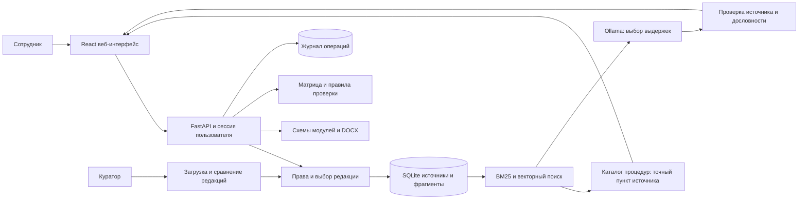

# Архитектура Регулы

Регула отделяет выбор оснований языковой моделью от операций с документами. Модель выбирает выдержки для свободного вопроса и предлагает некоторые текстовые реквизиты. Критичные нормы, явные факты, экспорт, права доступа и обязательные участники согласования проверяются программными правилами.

## База знаний

PDF разбирается постранично, DOCX с учётом абзацев и таблиц. Повторяющийся учебный водяной знак исключается из поискового текста. Сохраняются номера пунктов, страницы, исходный файл, идентификаторы документа и версии. Уложенные в отдельный фрагмент перечисления сохраняют смысловой контекст.

Новая загрузка создаёт черновую редакцию. Куратор сравнивает изменения и активирует её. Предыдущий файл сохраняется. Обычный поиск использует активную редакцию, исторический запрос применяет отдельный фильтр дат. Нельзя смешивать сведения разных редакций без явного указания происхождения.

Фильтр доступа выполняется до ранжирования и до формирования контекста модели. Скачивание исходников защищается теми же ролями. Право читать источник не даёт права активировать его новую редакцию.

## Поиск и ответы

Лексический поиск использует русские основы слов и BM25. После индексации векторов смысловой и лексический списки объединяются. Поисковый балл показывает порядок релевантности, а не вероятность достоверности ответа.

Каталог процедур распознаёт тип вопроса и выбирает нужный пункт из разрешённой редакции. Он не хранит сроки вместо источника: при отсутствии пункта или несовпадении сигнатуры правило не применяется. Для остальных запросов модель получает только найденные разрешённые фрагменты и возвращает структурированные пары `source_id, quote`. Проверка требует дословной непрерывной цитаты с нормализацией пробелов и существующего источника. Сервер собирает ссылки и полный применимый состав виз из строки таблицы. Не прошедший проверку вывод заменяется явно неполными поисковыми выдержками. Отсутствующий документ, лишь упомянутый модулем, не считается доступным основанием.

Модель не имеет инструментов подписи, отправки писем, исполнения команд или произвольного чтения файлов. Её вывод не превращается в действие без прикладной валидации. В отсутствие Ollama приложение использует выдержки из источников и явно показывает этот режим.

## Документы и маршруты

Для семи исходных модулей заданы типизированные поля и правила. Конструктор сохраняет постоянные формулировки оригинала, заполняет повторяющиеся реквизиты, удаляет неприменимые варианты и пояснения, оставляет служебные зоны даты, номера и ЭП. Условная отмена прежнего акта меняет нумерацию. Экспорт не присваивает официальный номер и не имитирует подпись.

Предложение заполнения не меняет проект. Явные факты извлекаются из отдельных фраз, противоречащие значения исключаются. LLM используется только для оставшихся подходящих текстовых полей, с проверяемым основанием в сообщении. Пользователь видит старое и новое значение и выбирает поля. Запись проверяет ревизию атомарно внутри транзакции SQLite; другая вкладка не перезаписывается незаметно. Автоматические значения отделены от подтверждённых, а показатель заполненности — от проверки человеком. Все эти состояния учитываются при экспорте.

Маршрут учитывает тип, содержание, кадровые и ИТ-признаки, изменение доступа и адресата письма. Применимые строки матрицы объединяются. Сокращённое согласование модуля не отменяет обязательные визы. Для спорной квалификации выводятся вопросы, а не произвольное окончательное решение.

Проверка проекта разделяет ошибки, предупреждения и информационные замечания. Для DOCX доступны реальные параметры оформления. Для PDF/текста проверка ограничивается доступной текстовой структурой, о чём говорится в результате.

## Хранение и внедрение

Прототип использует SQLite с WAL и файловое хранилище на одном узле. Это упрощает воспроизводимый запуск и автономную демонстрацию. При росте нагрузки можно вынести метаданные в PostgreSQL, векторы в отдельное хранилище, файлы в S3-совместимый сервис и обработку в очередь, сохранив контракт API.

Корпоративный этап включает SSO, серверные ACL из кадровой системы, утверждённый реестр модулей, антивирус, шифрование хранилища, метрики и резервирование. Интеграция с ИИС ДО должна создавать проект и тематические связи, а не обходить этапы подписи и регистрации.
